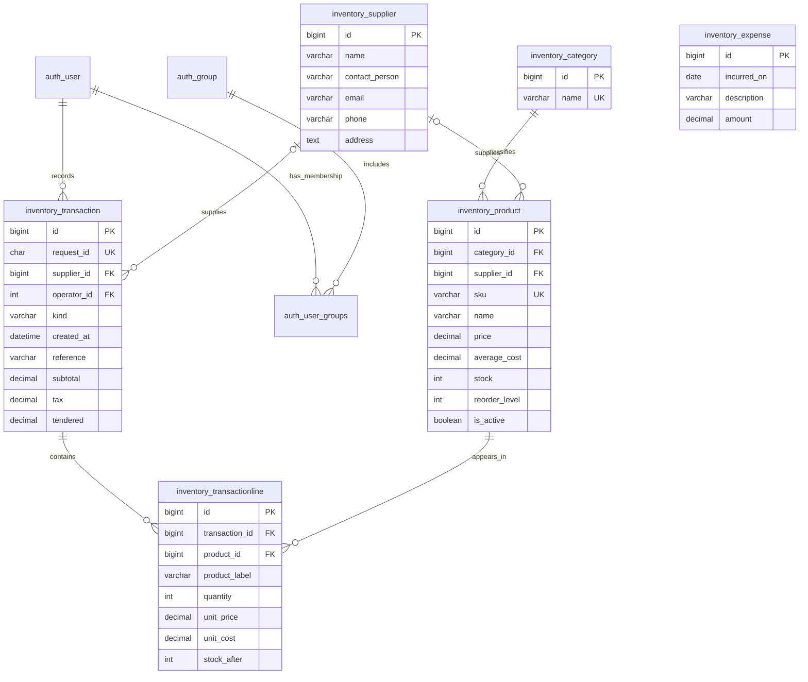
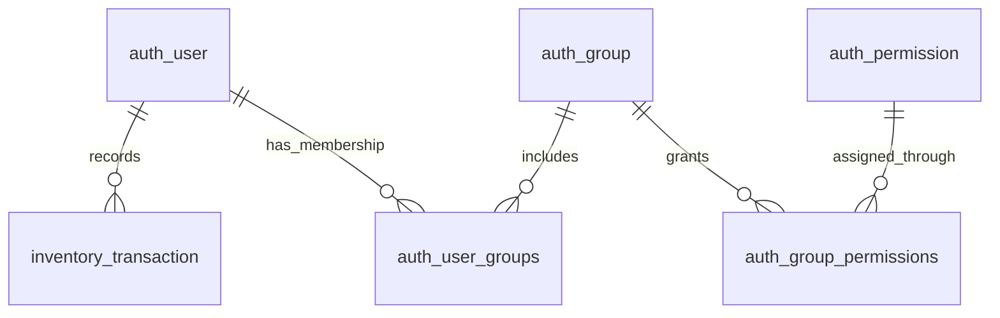

# Database Design – Sales and Inventory Management System

## 1. Simple Database Design

The system uses six business tables. Django supplies the account and permission tables.

| Table | Main Information |
|---|---|
| inventory_category | Category name |
| inventory_supplier | Company and contact details |
| inventory_product | SKU, name, category, preferred supplier, price, stock, reorder level |
| inventory_transaction | Type, date, operator, supplier, reference, payment totals |
| inventory_transactionline | Product, quantity, sale price, historical cost, resulting stock |
| inventory_expense | Date, description, amount |

A transaction has one of four types: sale, purchase, stock addition, or stock deduction. Its lines allow several products in one receipt. Expenses are independent entries used in the profit-and-loss report.

## 2. Main Crow's-Foot ERD

The diagram uses the actual Django table names. It shows the main keys and relationships.

The database allows a header to have zero or more lines. The application posts at least one line with each completed transaction. Each line belongs to exactly one transaction and one product. The pair of transaction and product IDs is unique.

The supplier relationship is optional at database level. The purchase form requires a supplier. The preferred supplier on a product is optional.

## 3. User and Role Relationships

Administrator accounts use Django's superuser flag. Cashier and Inventory Clerk are groups. The application checks group membership for posting actions and Django permissions for catalog access. Django also supports direct user permissions through auth_user_user_permissions.

## 4. Normalization and Integrity

Each table has a primary key. Categories and supplier details are stored separately and referenced through foreign keys. A transaction header stores information shared by its items. Individual items are stored in TransactionLine. This avoids repeating a supplier address or transaction date for every item.

Historical product labels, prices, and costs describe a line at the time it was posted. Current stock, average cost, and transaction subtotals are deliberately stored calculated values. These represent controlled redundancy.

Database constraints protect foreign keys, unique SKUs, unique request IDs, positive line quantities, nonnegative selling prices, and positive expense amounts. The application validates available stock and payment, locks product rows, and saves the entire posting in one database transaction. Repeated submissions with the same request ID reuse the posted record.

## 5. Requirement Coverage

| Project Requirement | Supporting Design |
|---|---|
| Product management and reorder alerts | Product and Category |
| Sales and printable receipts | Transaction and TransactionLine |
| Purchasing and stock-in records | Supplier, Transaction and TransactionLine |
| Supplier history | Supplier foreign key on purchase transactions |
| Sales and movement reports | Transaction dates, types and item quantities |
| Profit and loss | Historical line cost and Expense |
| Role-based access | Django users, groups and permissions |
| Backup and recovery | MySQL backup script and documented restore procedure |

Reports, exports, receipts, and backup scheduling are application or operational functions. Demonstrate them alongside the ERD.