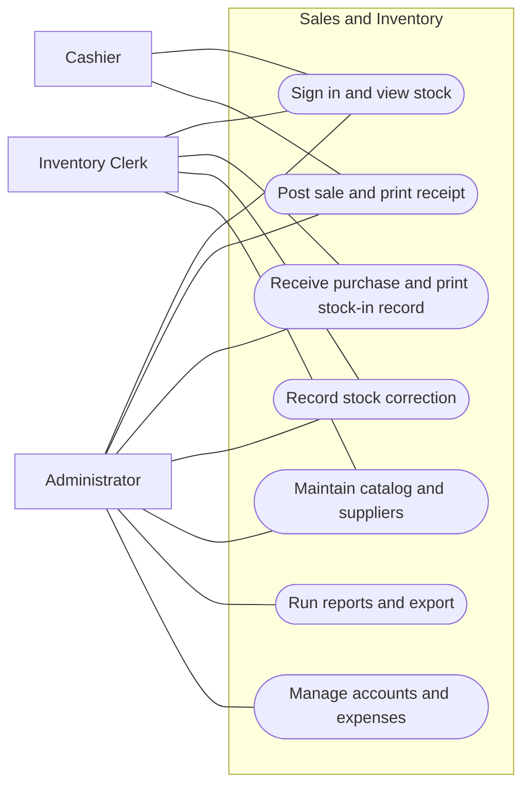
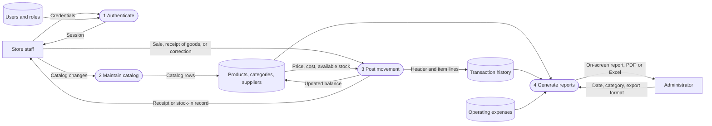
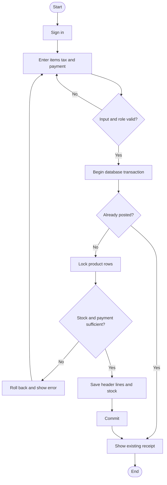
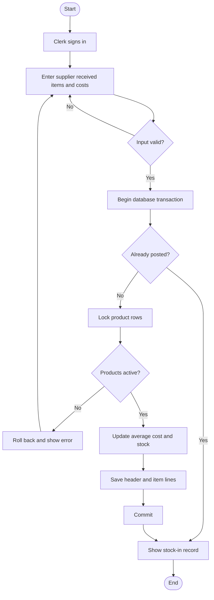

# System Diagrams – Sales and Inventory Management System

## 1. Use Case Diagram

## 2. Level 1 Data Flow Diagram

## 3. Sales Activity Diagram

## 4. Purchasing Activity Diagram

## 5. Diagram Explanation

The use case diagram presents the responsibilities of the Administrator, Cashier, and Inventory Clerk.

The Level 1 data flow diagram illustrates how staff interact with authentication, catalog management, transaction posting, and reporting processes.

The sales activity diagram shows the validation, stock checking, transaction processing, and receipt generation steps when posting a sale.

The purchasing activity diagram shows the process of receiving goods, validating products, updating stock and average cost, and recording the purchase transaction.